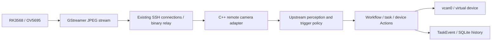

# Edge Agent Runtime

[](https://github.com/gulu-123/edge-agent-runtime/actions/workflows/ci.yml)
[](https://docs.ros.org/en/jazzy/)
[](adapters_ws/src/remote_camera_adapter)
[](docs/validation.md)
[](LICENSE)

**面向具身智能的边缘任务执行与视觉接入框架，基于 ROS 2，集成受控工作流、设备协议交互与任务追踪。**

Edge task execution and remote vision integration for embodied-agent systems,
built on a pinned ROS 2 runtime. Validated with RK3568/OV5695, a C++ MJPEG
adapter and reproducible image/live-stream experiments.

## 项目做什么

摄像头识别到 ArUco 标记后，经过连续帧确认，提交工作流；设备响应和任务结果可在
CAN 报文、TaskEvent 与 SQLite 中对应核对。持续展示同一标记只触发一次，移开后允许重新触发。



## 实现与来源

本仓库是 **视觉接入与集成验证项目**，基于
[Quchaosheng/embodied-agent-runtime](https://github.com/Quchaosheng/embodied-agent-runtime)。
上游固定在 [`93a3001`](https://github.com/Quchaosheng/embodied-agent-runtime/tree/93a30014b0a260c92a1d3593889afb6dec94e257)，
首次构建时下载到 `repo/`，不重复提交上游源码。

| 本仓库提供 | 上游运行时提供 |
|---|---|
| 独立 C++ MJPEG 输入适配器 | ArUco 检测与三帧确认、重复触发抑制规则 |
| 板子到 Linux/虚拟机的 SSH 二进制传图 | 行为树及分层 ROS 2 Actions |
| 图片与连续流的启动、核对和清理脚本 | CAN 协议、超时、取消、STOP 和故障处理 |
| 真实板卡实验方法与结果摘要 | 监控诊断、TaskEvent、SQLite 任务历史 |
| 固定依赖版本、配置示例与 CI 回放 | 原有 11 包测试与虚拟 CAN E2E |

连续帧入口调用原库的 `process_frame(frame, false)`，复用原触发状态机。
新增代码位于 `adapters_ws/` 和 `scripts/`。来源与许可证见 [NOTICE](NOTICE)。

## 已验证结果

2026-11-13，使用讯为 RK3568（4 GB / 32 GB）、OV5695、Buildroot 与
Ubuntu 24.04 / ROS 2 Jazzy 虚拟机完成真实视觉实验：

| 检查 | 结果 |
|---|---|
| 单帧输入 | 1920×1080 NV12 转图片，识别 ID 10 并触发一次任务 |
| 连续输入 | 接收 693 帧，约 5.001 fps，输出 960×540 JPEG |
| 首次确认 | 连续三帧 ID 10，第 3 帧触发 |
| 重复触发抑制 | 触发后连续展示 370 帧，没有新增任务 |
| 移开后重新启用 | 连续无映射标记后，第 683 帧触发第二次 |
| 结果核对 | 两条终态任务、两条 SQLite 记录、两组匹配的 CAN 指令和响应 |
| 软件基线 | 上游 11 包构建与测试成功，七个虚拟 CAN E2E 场景通过 |

完整范围及首轮未通过记录见 [验证说明](docs/validation.md)。CI 的生成图像回放与真实摄像头实验分别标注。

**当前设备端使用虚拟 CAN 设备，成功结果表示匹配的协议 ACK。物理执行器运动、物理 CAN 接线、硬件急停、自动重连和板端任务面板不在本版验证范围内。**

## 环境

- 运行端：Ubuntu 24.04、ROS 2 Jazzy、Python 3.10+、C++17、Linux `vcan`。
- 板端：可正常预览的 OV5695 驱动、GStreamer 的 `v4l2src/videorate/videoscale/jpegenc/fdsink`、SSH 服务。
- 中转端：Python 3.10+ 与 OpenSSH 客户端，支持 Windows，也可在 Linux 使用。
- 运行端可以是 VMware Linux 虚拟机；实时输入通过现有 SSH 连接传输。

本版保留板端 Buildroot。运行端的 ROS 2 Jazzy 需要单独安装，下面的脚本不负责刷机或安装 ROS 本体。

## 快速开始

在 Ubuntu 运行端执行：

```bash
git clone https://github.com/gulu-123/edge-agent-runtime.git
cd edge-agent-runtime
bash scripts/install-deps.sh
bash scripts/build-test.sh
bash scripts/setup-vcan.sh
bash scripts/demo.sh
```

`install-deps.sh` 使用 sudo 安装依赖，通过官方 rosdistro 的 Git 副本建立本地 rosdep 索引。
`build-test.sh` 构建和测试固定版本的上游，再构建本仓库适配器。编译并行度默认 2，可通过
`CMAKE_BUILD_PARALLEL_LEVEL` 调整。脚本不会重置已有的不同版本上游 checkout。

进入开发环境：

```bash
source scripts/env.sh
```

### 用图片触发任务

```bash
bash scripts/run-image.sh /absolute/path/to/marker-photo.png
```

图片使用 `DICT_4X4_50`。上游默认映射为 ID 10 → `single_task/dock_a`、
ID 20 → `ready_then_task/home`。未配置 ID 可以被检测，但不触发任务。

### 连续视觉验收

1. 确认板子可取图。默认采集 `/dev/video1`，它必须实际对应可用的 ISP 输出；按自己的板卡调整配置。
2. 在中转端分别确认能用现有 SSH 密钥登录板子和运行端，并核实已保存的主机指纹。
3. 将本仓库放到中转端，复制配置示例并填写自己的连接信息：

```bash
mkdir -p config/local
cp config/relay.example.json config/local/relay.local.json
```

4. 在中转端运行：

```bash
python scripts/relay_live.py --config config/local/relay.local.json
```

Windows PowerShell 也可使用：

```powershell
powershell -File .\scripts\start-live.ps1
```

5. 使用手机屏幕或纸张展示 **DICT_4X4_50、ID 10**：
   - 放入并保持至少 5 秒：产生第一次任务，持续展示不重复触发。
   - 完全移开至少 3 秒：等待无映射标记的连续帧。
   - 再放回并保持至少 5 秒：产生第二次任务，验收自动结束。

该入口是有时限的两次展示实验，默认最长约五分钟；其验收预期固定为 ID 10 与 `dock_a`。
底层的 ID 20 映射仍可用，但不属于这个验收场景。`run-live.sh` 是接收端，需要 MJPEG stdin，
不单独作为摄像头启动器使用。

### 无摄像头回放

Linux 已启用 `vcan0` 并构建完成后：

```bash
source scripts/env.sh
python3 tests/replay_smoke.py
```

回放在内存中生成标记图像，验证同一输入适配器和任务链路，不代表实体相机测试。

## 文件组织

```text
adapters_ws/src/remote_camera_adapter/  自有 C++ 连续帧入口
scripts/                              安装、构建、图片、连续流及中转入口
config/                               固定上游版本与脱敏配置示例
tests/                                配置边界测试、生成 JPEG 集成回放
docs/                                 实验方法和结果摘要
tools/                                发布文件检查
repo/                                 自动下载的上游（忽略）
runs/ logs/ cache/                     本地运行结果与缓存（忽略）
```

每次验证结果保存在 `runs/<时间戳>/`，包括逐帧元数据、触发时 JPEG、TaskEvent、CAN 报文、
SQLite 和节点日志。个人连接配置位于 `config/local/`。这些文件均不纳入 Git。

## 常见问题

见 [排查说明](docs/troubleshooting.md)，包括摄像头未探测、预览占用、Buildroot 主目录、
虚拟机网络、回放范围及 ACK 的含义。

## 许可证

本仓库采用 [Apache License 2.0](LICENSE)。上游及其他依赖保留各自许可证，见
[NOTICE](NOTICE) 与 [第三方说明](THIRD_PARTY_NOTICES.md)。
